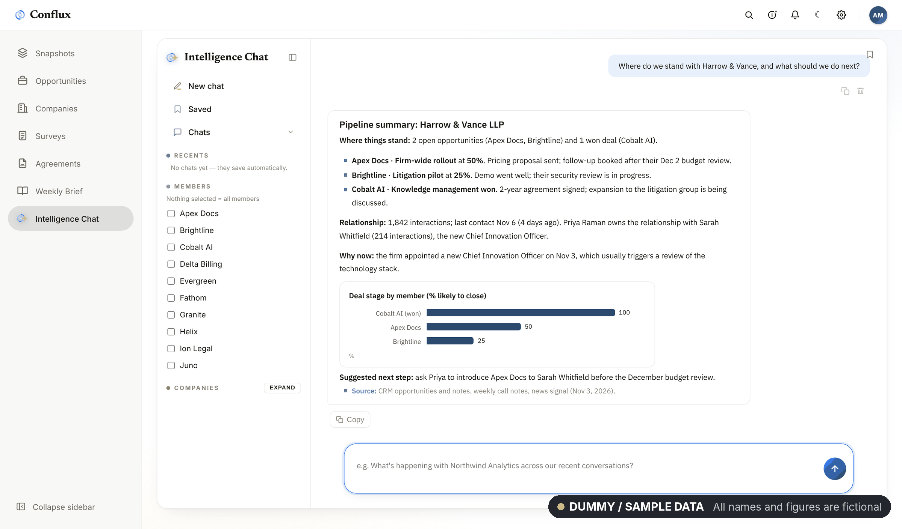
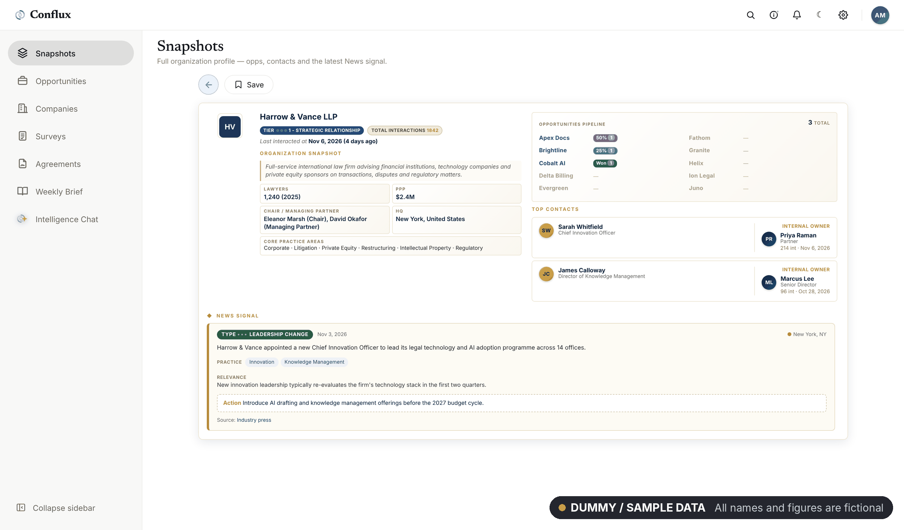
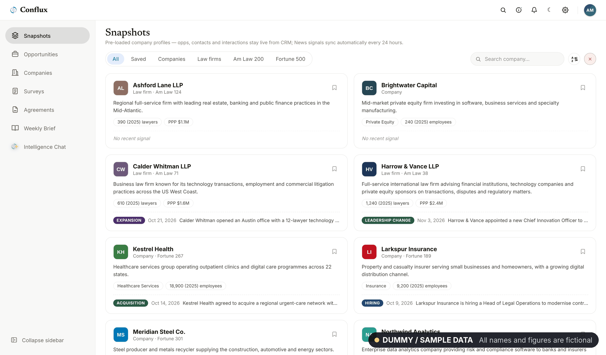
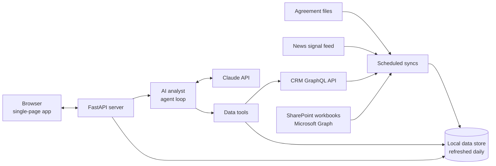
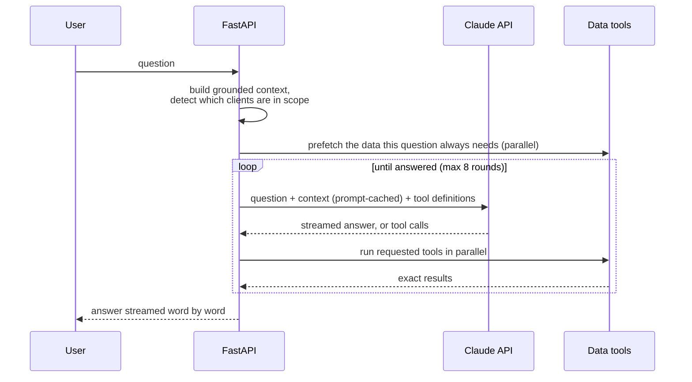

# Conflux: GenAI Intelligence Platform

A web platform that brings CRM opportunities, client notes, survey responses, meeting notes and agreement documents into one place, with an AI analyst on top that answers questions in plain English by calling live data tools instead of guessing.

> **Note:** this platform runs in production on client data, so the source code is private. This repository documents the design, architecture and results. Screenshots show the real interface running on **dummy / sample data**: all company names, people and figures are fictional.

---

## The problem

Client and partner knowledge was spread across a CRM, several SharePoint workbooks, weekly meeting notes and agreement files. Answering a simple question such as "where do we stand with this client?" meant opening four systems and took around an hour.

## What it does

- **One hub for four CRM and SharePoint sources:** opportunities and their stages, client notes, survey responses, weekly meeting notes, a full company directory and member agreements.
- **AI analyst chat** that answers questions by calling tools against live data, with grounding rules that keep answers to what the data says.
- **Company snapshots** with profile, opportunities, key contacts, relationship owners and the latest news signal.
- **Agreements library** that reads PDFs, Outlook emails, Word, PowerPoint and Excel files and makes them searchable by the AI.
- **Answers to documents:** any chat answer can be downloaded as a styled PDF or Word file.

**Result:** client research that took about 60 minutes now takes seconds.

## Screenshots

| Company snapshot | Snapshot library |
|---|---|
|  |  

---

## Architecture

### The AI analyst

- **Tool calling for exact numbers.** Six tools cover opportunity statistics, company search across a 20,000+ company directory, contacts and relationship owners, a partner's relationships, interaction totals, and agreement search. Counts are computed in code, never estimated by the model.
- **Grounding rules.** The model is instructed to answer only from the supplied context and tool results, and to cite where an answer came from.
- **Prompt caching.** The large data context is cached, so follow-up questions are faster and cheaper.
- **Streaming.** Answers stream to the browser over Server-Sent Events, so text appears within seconds.
- **Conversation memory.** The analyst keeps track of which clients a conversation is about, so follow-up questions stay in scope.

### Data syncs

- **Daily refresh** of workbooks and CRM data at a fixed time, with step-by-step progress shown in the UI. If a source is unreachable, the previous data is kept so the site never goes blank.
- **Incremental news sync** using a watermark: only signals newer than the last run are scanned.
- **Schema-aware CRM queries.** The GraphQL schema is introspected at runtime and queries are built from the fields that exist, so CRM changes don't break the sync.
- **Change notifications.** Each refresh compares old and new opportunity data and posts a summary of what changed.
- **Document text extraction** runs once per file and is cached, so only new agreements are downloaded.

### Security

- Passwords stored as **PBKDF2** hashes; sessions use **HMAC-signed cookies** with expiry.
- Changing a password signs out every other session.

### Deployment

- Runs on **Oracle Cloud (OCI)** as a **systemd** service that restarts on failure.
- **Caddy** in front provides automatic HTTPS.
- One-command deploys from a laptop with rsync, preserving data that lives on the server.

---

## Tech stack

| Area | Tools |
|---|---|
| Backend | Python, FastAPI, Pydantic |
| Frontend | JavaScript single-page app (History API routing), installable as a PWA |
| AI | Claude API (tool calling, streaming, prompt caching) |
| Data sources | CRM GraphQL API, Microsoft Graph (SharePoint), news signal API |
| Documents | pypdf, extract-msg, python-docx, reportlab |
| Infrastructure | Oracle Cloud, Linux, systemd, Caddy |

## What I learned

- **Let the model ask, let code count.** Exact figures come from tools; the model only decides what to look up and how to explain it.
- **Prefetch the obvious.** Running the lookups every question needs before the first model call removed several slow round trips.
- **Keep the last good data.** A failed refresh should never replace working data with nothing.

---

## Author

**Adiba Khan** · Software Engineer · Backend & Microservices · GenAI Systems

